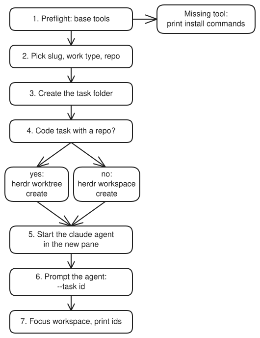

# wStack

wStack is a Claude Code plugin. It runs one fixed pipeline for development and editing work. AI agents do the work. You start a task, confirm the spec, and approve each step that you cannot undo.

## The pipeline

You type `/wstack:start-task <rough idea>`. Then the task goes through five steps:

1. Trigger: the launcher creates a task folder in your Obsidian vault and opens a new herdr workspace for the task. herdr is a terminal workspace manager.
2. Confirmation: an agent turns your idea into a spec and you approve it.
3. Execute: an agent does the work and writes each step to `run-log.md`. It stops only before a step that you cannot undo.
4. Verify: an agent runs each check from the spec and records evidence. A reviewer agent then reviews the result. The review page shows the findings.
5. Deliver: the agent sends the result to the targets in the spec. A merge always waits for your approval.

If a check fails and the spec is right, the task goes back to Execute. It tries again up to `retry_limit` times, then waits for you. If the spec is wrong, the task goes back to Confirmation.

Once a week, run `/wstack:retro`. It reads the task folders of the last 7 days and proposes improvements to wStack. You choose which proposals to apply.


### The launcher

`/wstack:start-task <rough idea>` runs a launcher inside herdr. The launcher starts a separate Claude session for each task. The session name is the same everywhere: the slug (a short name made from your idea) is the herdr workspace label, the agent name, and the Remote Control name.



wStack accepts the folder trust prompt for the worktree that it creates from your repository, so the `.claude` hooks and MCP servers of that repository load in the task.

Outside herdr, the launcher opens no workspace. The task runs in your current Claude session.

To resume an open task, run `/wstack:start-task` with no arguments. It lists the open tasks and asks which one to resume.

Add `--mobile` to the idea to publish the spec page and the review page as Claude artifacts, so you can read them on a phone.

## Install

wStack needs the `answer-me-with-html` plugin. If it is not installed, add its marketplace first:

```
claude plugin marketplace add QingYunA/answer-me-with-html
claude plugin install answer-me-with-html@answer-me-with-html
```

The GitHub repository 21-BreakinCode/wStack is private. If you have no GitHub access yet, run `gh auth login` first. Then add wStack:

```
claude plugin marketplace add 21-BreakinCode/wStack
claude plugin install wstack@wstack
```

`/wstack:start-task` checks the base tools first. To run the same check yourself from a clone of this repository, run:

```
bash scripts/preflight.sh base
```

The script only reports. It never installs anything. Each missing tool comes with its install command. These are the base commands:

```
xcode-select --install
brew upgrade gh
mise use -g node@26
brew install jq
claude update
npm i -g @playwright/cli@0.1.24
brew install herdr
```

herdr is optional. Without it, preflight only warns.

Some work types need more tools. After you approve the spec, Confirmation runs `preflight.sh plan <need>...` and reports them when the task needs them. The needs are `web`, `video`, `webp`, `terminal`, `r2`, and `diagram`. For example, `brew install ffmpeg` gives video capture, and `brew install webp` gives WebP images.

## Configuration

Claude Code asks for these values when you install wStack.

| Key | Default | Meaning |
|---|---|---|
| `vault_path` | none, required | Absolute path of your Obsidian vault. |
| `tasks_dir` | `Workflow/Tasks` | Task folder root, relative to `vault_path`. |
| `retry_limit` | `3` | Maximum fix-and-verify loops before the task waits for you. |
| `r2_bucket` | empty | Name of the R2 bucket for evidence. If it is empty, evidence stays on your Mac. |
| `evidence_domain` | empty | Custom domain, protected by Cloudflare Access, that serves the evidence files. |
| `evidence_retention_days` | `30` | Days before the R2 lifecycle rule deletes evidence. |
| `local_evidence_only_repos` | empty list | Repositories (`owner/repo`) whose evidence never leaves your Mac. |
| `pr_media_max_mb` | `10` | Size limit in MB for each pull request attachment. |

If you set `r2_bucket` and `evidence_domain`, you agree that Verify uploads evidence to that bucket under `evidence/<task_id>/`.

## Evidence

During Verify, the agent records evidence for each check: API logs, screenshots, videos, and terminal recordings. It compresses the files and uploads them to the private R2 bucket under `evidence/<task_id>/`. Evidence never goes into the vault. Review pages link to `https://<evidence_domain>/evidence/<task_id>/<file>`. Cloudflare Access protects that domain. After a merge, the agent deletes the evidence of that task from R2. The merge question names this delete.

## Setup to-dos

Do these steps once, in this order. Cloudflare steps are only needed if you want evidence in R2. Without them, evidence stays on your Mac.

1. Get a domain on Cloudflare. Cloudflare Access needs it for the evidence subdomain.
2. Create the R2 bucket.
3. Add the lifecycle rule: prefix `evidence/`, delete after 30 days (`evidence_retention_days`). The command replaces all lifecycle rules of the bucket. It needs a Node version that `cf` accepts, which `bash scripts/preflight.sh plan r2` checks. Add `--dry-run` first to see the request. Replace `<bucket>` with your bucket name. The value `2592000` is 30 days in seconds. If you change `evidence_retention_days`, change this number to match.

   ```
   cf r2 buckets lifecycle update <bucket> --rules '[{"id":"expire-evidence","enabled":true,"conditions":{"prefix":"evidence/"},"deleteObjectsTransition":{"condition":{"type":"Age","maxAge":2592000}}}]'
   ```

4. Create the Cloudflare Access application and an Allow policy with your email.
5. Connect the custom domain to the bucket. Do this after step 4.
6. Check your company policy for evidence from work repositories. List those repositories in `local_evidence_only_repos`.
7. Update gh to v2.99.0 or later (`brew upgrade gh`).
8. Install `answer-me-with-html` (see Install).
9. Install wStack and fill in the configuration values.

## Layout


## Diagrams

The diagrams in `docs/diagrams/` are Excalidraw scenes. To render a scene to SVG, run:

```
bash scripts/render-excalidraw.sh docs/diagrams/pipeline.excalidraw docs/diagrams/pipeline.svg
```

The script needs `playwright-cli` and network access to the jsDelivr CDN.

## Tests

Run `bash tests/run-all.sh` before every commit.

## More

- `docs/spec.md` is the spec.
- `docs/decisions.md` holds decisions and spike results.
- `CHANGELOG.md` lists the changes of each version.
