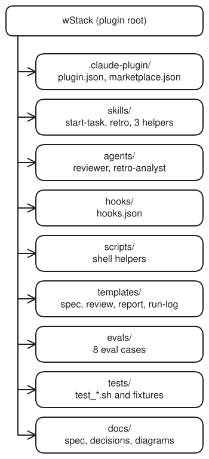

# wStack

wStack is a Claude Code plugin. It runs one fixed pipeline for development and editing work. AI agents do the work. You start a task, confirm the spec, and approve each step that you cannot undo.

## The pipeline

You type `/wstack:start-task <rough idea>`. Then the task goes through five steps:

1. Trigger: the launcher creates a task folder in your Obsidian vault and opens a new herdr workspace for the task. herdr is a terminal workspace manager.
2. Confirmation: an agent turns your idea into a spec and you approve it.
3. Execute: an agent does the work and writes each step to `run-log.md`. It stops only before a step that you cannot undo.
4. Verify: an agent runs each check from the spec and records evidence. A reviewer agent then reviews the result. The review page shows the findings.
5. Deliver: the agent sends the result to the targets in the spec. A merge always waits for your approval.

If a check fails and the spec is right, the task goes back to Execute. It tries again up to `retry_limit` times, then waits for you. If the spec is wrong, the task goes back to Confirmation.

Once a week, run `/wstack:run-retro`. It reads the task folders of the last 7 days and proposes improvements to wStack. You choose which proposals to apply.


### The launcher

`/wstack:start-task <rough idea>` runs a launcher inside herdr. The launcher starts a separate Claude session for each task. The session name is the same everywhere: the slug (a short name made from your idea) is the herdr workspace label, the agent name, and the Remote Control name.


wStack accepts the folder trust prompt for the worktree that it creates from your repository, so the `.claude` hooks and MCP servers of that repository load in the task.

Outside herdr, the launcher opens no workspace. The task runs in your current Claude session.

To resume an open task, run `/wstack:start-task` with no arguments. It lists the open tasks and asks which one to resume.

Add `--mobile` to the idea to publish the spec page and the review page as Claude artifacts, so you can read them on a phone.

## Commands

User commands:

- `/wstack:start-task`: run the pipeline for one task.
- `/wstack:run-retro`: weekly retro over the last 7 days of task folders.
- `/wstack:init-org`: scaffold the handover initiation file for an org. Run it once per org.
- `/wstack:init-service`: set up the current repository for handovers. Run it once per repository.
- `/wstack:create-handover`: create a handover document from the current conversation.
- `/wstack:wrap-up-handovers`: wrap up all active handovers in the vault.

Helper skills (the agent uses them, you do not): `build-review-page`, `capture-evidence`, `deliver-task`.

## Handover

A handover document carries the state of a piece of work to the next session. The handover commands keep these documents in your Obsidian vault and link them into each repository.

1. Run `/wstack:init-org` once per org. It writes `handover_handler__initiation.md` in `01Project/<ORG>/` of the vault. That file holds the service mapping table.
2. Run `/wstack:init-service` once in each repository. It finds or adds the mapping row for the repository, and creates the vault folder if it is missing. It links `./handover` to that folder. It writes the entry `/handover` to the local git exclude file, which `git rev-parse --git-path info/exclude` names. It never edits `.gitignore`. If a gitignore already ignores `handover`, it changes nothing and prints `already present`.
3. Run `/wstack:create-handover` to write a handover document under `./handover/`, seeded from the conversation.
4. Run `/wstack:wrap-up-handovers` to wrap up. It finds the active handovers in the vault. It asks you for one batch of decisions, then archives, updates, or suspends each handover. Archived files go to `<vault>/04Archive/<ORG>/`. The archive root is fixed at `04Archive`.

The commands read the vault path from the `vault_path` setting. The resolvers find the org from the git remote, including `github_orgs` as a block list. They work inside herdr worktrees, because they look up the mapping row of the main checkout.

## Service contract

A service contract is one Markdown file for each mapped service. It states what the service does now. It lives in the vault next to the handover files. The path is `<vault>/01Project/<ORG>/<lifeos_subpath>/<app_name>.md`.

The vault files:

- `<app_name>.md`: the contract. Its sections are Team docs, Abilities, Interfaces, Depends on, Consumers, Gotchas, and Open questions. The frontmatter holds `base_branch`, `verified_commit`, `pending`, and `ignore`.
- `plan.md`: planned items that are not built yet.
- `decisions/`: one file for each decision, named `NNNN-<slug>.md`.
- `_archive/<task_id>/`: old vault files that a `contract` task moved.

The gate:

- A `code` or `ops` task runs the contract gate in Confirmation, before the spec is written.
- The gate fetches `origin/<base_branch>` and runs the drift check. It finds the sections that the changes since `verified_commit` made stale.
- The `contract-reader` agent writes a brief into `contract-brief.md` in the task folder. The spec reads it.
- After you approve the spec, the gate patch updates the contract and removes the built items from `plan.md`. If the patch covers each stale section, `verified_commit` moves to the checked commit.
- A gate stop starts its reason with `contract gate:`. When you answer, the gate runs again from the start.
- In Deliver, the write-back records a pending item for the pull request. After the merge, the next gate run writes the change into the contract. If the pull request closes without a merge, the gate drops the item.
- A repository with no service mapping gets no contract. The gate writes `Contract: not mapped` and goes on.
- Every write takes the lock folder `<contract>.lock`. If a crashed session leaves it, remove the folder.
- Undo uses copies in the task folder. The gate writes `contract.before.md` and `plan.before.md`. The write-back writes `contract.writeback.before.md` and `plan.writeback.before.md`. Each copy is written once.

The hooks: a SessionStart hook and a PostToolUse hook run `scripts/contract-hook.sh`. The PostToolUse hook runs only after `git pull`, `merge`, `rebase`, `switch`, `checkout`, or `reset`, and after `gh pr checkout`. A hook makes no network call and never blocks. If the contract is stale, it prints one line. Otherwise it prints nothing. It reads the vault path from `WSTACK_VAULT_PATH`, then from the `vault_path` setting.

To set up a contract:

1. Run `/wstack:init-org` and `/wstack:init-service`, so the repository has a service mapping.
2. Run `/wstack:start-task` with an idea such as "set up the service contract". The task is a `contract` task. Inside herdr, it runs in a workspace in the repository folder, with no worktree.
3. For a new project, answer one question for each section. For an existing project, the spec lists the team docs and code areas to read.
4. Approve the spec. Execute writes drafts in the task folder. Deliver moves old vault files into `_archive/<task_id>/` and writes the contract. It is safe to run again.

To ask why a service is the way it is, ask in any session. Claude sends the question to the `contract-historian` agent.

## Install

wStack needs the `answer-me-with-html` plugin. If it is not installed, add its marketplace first:

```
claude plugin marketplace add QingYunA/answer-me-with-html
claude plugin install answer-me-with-html@answer-me-with-html
```

The GitHub repository 21-BreakinCode/wStack is private. If you have no GitHub access yet, run `gh auth login` first. Then add wStack:

```
claude plugin marketplace add 21-BreakinCode/wStack
claude plugin install wstack@wstack
```

`/wstack:start-task` checks the base tools first. To run the same check yourself from a clone of this repository, run:

```
bash scripts/preflight.sh base
```

The script only reports. It never installs anything. Each missing tool comes with its install command. These are the base commands:

```
xcode-select --install
brew upgrade gh
mise use -g node@26
brew install jq
claude update
npm i -g @playwright/cli@0.1.24
brew install herdr
```

herdr is optional. Without it, preflight only warns.

Some work types need more tools. After you approve the spec, Confirmation runs `preflight.sh plan <need>...` and reports them when the task needs them. The needs are `web`, `video`, `webp`, `terminal`, `r2`, and `diagram`. For example, `brew install ffmpeg` gives video capture, and `brew install webp` gives WebP images.

## Configuration

Claude Code asks for these values when you install wStack.

| Key | Default | Meaning |
|---|---|---|
| `vault_path` | none, required | Absolute path of your Obsidian vault. |
| `tasks_dir` | `Workflow/Tasks` | Task folder root, relative to `vault_path`. |
| `retry_limit` | `3` | Maximum fix-and-verify loops before the task waits for you. |
| `r2_bucket` | empty | Name of the R2 bucket for evidence. If it is empty, evidence stays on your Mac. |
| `evidence_domain` | empty | Custom domain, protected by Cloudflare Access, that serves the evidence files. |
| `evidence_retention_days` | `30` | Days before the R2 lifecycle rule deletes evidence. |
| `local_evidence_only_repos` | empty list | Repositories (`owner/repo`) whose evidence never leaves your Mac. |
| `pr_media_max_mb` | `10` | Size limit in MB for each pull request attachment. |

If you set `r2_bucket` and `evidence_domain`, you agree that Verify uploads evidence to that bucket under `evidence/<task_id>/`.

## Evidence

During Verify, the agent records evidence for each check: API logs, screenshots, videos, and terminal recordings. It compresses the files and uploads them to the private R2 bucket under `evidence/<task_id>/`. Evidence never goes into the vault. Review pages link to `https://<evidence_domain>/evidence/<task_id>/<file>`. Cloudflare Access protects that domain. After a merge, the agent deletes the evidence of that task from R2. The merge question names this delete.

## Setup to-dos

Do these steps once, in this order. Cloudflare steps are only needed if you want evidence in R2. Without them, evidence stays on your Mac.

1. Get a domain on Cloudflare. Cloudflare Access needs it for the evidence subdomain.
2. Create the R2 bucket.
3. Add the lifecycle rule for evidence: prefix `evidence/`, delete after 30 days (`evidence_retention_days`). Replace `<bucket>` with your bucket name. The update command replaces all lifecycle rules of the bucket. A new bucket has a default rule that aborts incomplete multipart uploads after 7 days (`604800` seconds). Keep that rule in the command.
   1. Run `cf r2 buckets lifecycle get <bucket>`. Note each rule in the output.
   2. Run the update command below with `--dry-run` at the end. Check the request body. It must list the default rule and the `expire-evidence` rule. If step 1 shows other rules, add them to `--rules` too.
   3. Run the same command without `--dry-run`. The command asks you to confirm before it changes the bucket. In a script, add `--force` to skip the question.

   ```
   cf r2 buckets lifecycle update <bucket> --rules '[{"id":"Default Multipart Abort Rule","enabled":true,"conditions":{},"abortMultipartUploadsTransition":{"condition":{"type":"Age","maxAge":604800}}},{"id":"expire-evidence","enabled":true,"conditions":{"prefix":"evidence/"},"deleteObjectsTransition":{"condition":{"type":"Age","maxAge":2592000}}}]'
   ```

   The value `2592000` is 30 days in seconds. If you change `evidence_retention_days`, change this number to match. The command needs a Node version that `cf` accepts. `bash scripts/preflight.sh plan r2` checks it.

4. Create the Cloudflare Access application and an Allow policy with your email.
5. Connect the custom domain to the bucket. Do this after step 4.
6. Check your company policy for evidence from work repositories. List those repositories in `local_evidence_only_repos`.
7. Update gh to v2.99.0 or later (`brew upgrade gh`).
8. Install `answer-me-with-html` (see Install).
9. Install wStack and fill in the configuration values.

## Layout



## Diagrams

The diagrams in `docs/diagrams/` are Excalidraw scenes. To render a scene to SVG, run:

```
bash scripts/render-excalidraw.sh docs/diagrams/pipeline.excalidraw docs/diagrams/pipeline.svg
```

The script needs `playwright-cli` and network access to the jsDelivr CDN.

## Tests

Run `bash tests/run-all.sh` before every commit.

## More

- `docs/spec.md` is the spec.
- `docs/decisions.md` holds decisions and spike results.
- `CHANGELOG.md` lists the changes of each version.
