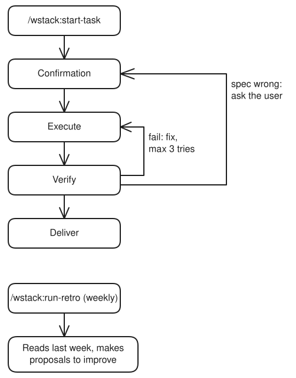

# wStack

wStack is a Claude Code plugin. It runs one fixed pipeline for development and editing work. AI agents do the work. You start a task, confirm the spec, and approve each step that you cannot undo.

## The pipeline

You type `/wstack:start-task <rough idea>`. Then the task goes through five steps:

1. Trigger: the launcher creates a task folder in your Obsidian vault and opens a new herdr workspace for the task. herdr is a terminal workspace manager.
2. Confirmation: an agent turns your idea into a spec and you approve it.
3. Execute: an agent does the work and writes each step to `run-log.md`. It stops only before a step that you cannot undo.
4. Verify: an agent runs each check from the spec and records evidence. A reviewer agent then reviews the result. The review page shows the findings.
5. Deliver: the agent sends the result to the targets in the spec. A merge always waits for your approval.

If a check fails and the spec is right, the task goes back to Execute. It tries again up to `retry_limit` times, then waits for you. If the spec is wrong, the task goes back to Confirmation.

Once a week, run `/wstack:run-retro`. It reads every finished task that no retro read yet and proposes improvements to wStack. It also checks the service contract of the current repository for drift, and proposes updates for the stale sections. You choose which proposals and sections to apply.



### The launcher

`/wstack:start-task <rough idea>` runs a launcher inside herdr. The launcher starts a separate Claude session for each task. The session name is the same everywhere: the slug (a short name made from your idea) is the herdr workspace label, the agent name, and the Remote Control name.


wStack accepts the folder trust prompt for the worktree that it creates from your repository, so the `.claude` hooks and MCP servers of that repository load in the task.

Outside herdr, the launcher opens no workspace. A `code` task gets a worktree at `<root>/<repo>/<branch-slug>`, the place where herdr puts its worktrees. `<root>` is the `directory` under `[worktrees]` in the herdr configuration, or `~/.herdr/worktrees`. The agent tells you to run `claude` from that folder. Other task types run in your current Claude session.

To resume an open task, run `/wstack:start-task` with no arguments. It lists the open tasks and asks which one to resume.

Add `--mobile` to the idea to publish the spec page and the review page as Claude artifacts, so you can read them on a phone.

## Commands

User commands:

- `/wstack:start-task`: run the pipeline for one task.
- `/wstack:run-retro`: weekly retro over every finished task that no retro read yet, with a drift check of the service contract of the current repository.
- `/wstack:board`: show every open task session in groups, the ones that wait for you first. A task session is also called an RD. Each row has its `herdr workspace focus` command. Each row also shows the size of the task's changes, such as `2 files +4 -1`. The command writes a snapshot page `Board/board.html` in a Notion style next to the `Retros` folder. It also offers to close the workspaces of finished tasks. A worktree with changes stays. `/wstack:board --watch` opens a live monitor in a new herdr pane below your session. It refreshes every 3 seconds and shows, for each RD, its stage, the tool it calls now, and each running subagent with its tool. A Bash call shows only its description, never its command text. Outside herdr, the command prints the line to run in another terminal.
- `/wstack:pause-work`: pause the work of any session. It writes a resume note, then stops the background agents, shells, and processes the session started. Run it before you close the computer.
- `/wstack:resume-work`: resume from the newest resume note of the current folder. For a task, it prints `cd "<workspace_cwd>" && claude "/wstack:start-task --task <task_id>"`, so the task resumes in its own folder with its configuration values.
- `/wstack:init-org`: scaffold the handover initiation file for an org. Run it once per org.
- `/wstack:open-contract [<service>] [--note]`: open the HTML page of a service contract in the browser. With no service name, it opens the contract of the current repository. With `--note`, it opens the vault note in Obsidian. It renders the page again first when the page is missing or older than the contract. If no contract matches, it lists the rendered contracts. A session can also run it when you ask to see a contract.
- `/wstack:draw-contract [<service>] [<what to draw>]`: draw a deep dive of a service contract with the diagram-design plugin. `<what to draw>` is `flow`, `sequence:<id>`, `states:<id>`, or `architecture`. With no value, it draws `flow`. The deep dive is an HTML file in the `diagrams/` folder next to the contract. The contract page links it. If the contract changed that part of the `diagrams` block after the drawing, the page marks the deep dive stale. If you ask to draw a contract, a session can also run it.
- `/wstack:init-service`: set up a repository for handovers. Run it once per repository. `/wstack:init-service <repo-path> ...` sets up each repository you name, from any folder. `/wstack:init-service --check` reports the state of every mapped repository and changes nothing.
- `/wstack:create-handover`: create a handover document from the current conversation.
- `/wstack:wrap-up-handovers`: wrap up all active handovers in the vault.

Helper skills (the agent uses them, you do not): `build-review-page`, `capture-evidence`, `deliver-task`.

## Handover

A handover document carries the state of a piece of work to the next session. The handover commands keep these documents in your Obsidian vault and link them into each repository.

1. Run `/wstack:init-org` once per org. It writes `handover_handler__initiation.md` in `01Project/<ORG>/` of the vault. That file holds the service mapping table.
2. Run `/wstack:init-service` once in each repository. It finds or adds the mapping row for the repository, and creates the vault folder if it is missing. It links `./handover` to that folder. It writes the entry `/handover` to the local git exclude file, which `git rev-parse --git-path info/exclude` names. It never edits `.gitignore`. If a gitignore already ignores `handover`, it changes nothing and prints `already present`. Before it writes, it asks you to approve each repository, and it shows the link path and the exclude file path. To set up several repositories at once, pass their paths. Run `/wstack:init-service --check` to check every row of the mapping table. For each row, it reports whether the repository exists, whether `./handover` links to the vault folder, whether git ignores `handover`, whether the vault folder exists, and the state of the contract. It then offers to run the setup for the rows that need it.
3. Run `/wstack:create-handover` to write a handover document under `./handover/`, seeded from the conversation.
4. Run `/wstack:wrap-up-handovers` to wrap up. It finds the active handovers in the vault. It asks you for one batch of decisions, then archives, updates, or suspends each handover. Archived files go to `<vault>/04Archive/<ORG>/`. The archive root is fixed at `04Archive`.

The commands read the vault path from the `vault_path` setting. The resolvers find the org from the git remote, including `github_orgs` as a block list. They work inside herdr worktrees, because they look up the mapping row of the main checkout.

## Service contract

A service contract is one YAML file for each mapped service. It states what the service does now. It lives in the vault next to the handover files. The path is `<vault>/01Project/<ORG>/<lifeos_subpath>/<app_name>.contract.yaml`.

The vault files:

- `<app_name>.contract.yaml`: the contract. It is the only source of truth. The top keys are `app_name`, `repo`, `base_branch`, `verified_commit`, `verified_at`, `pending`, `ignore`, `tags`, `summary`, `sections`, and `planned`. `sections` has seven fixed keys: `team_docs`, `abilities`, `interfaces`, `depends_on`, `consumers`, `gotchas`, and `open_questions`. `team_docs`, `abilities`, `interfaces`, and `depends_on` list their `sources` globs. Each claim carries refs such as `api/routes.go:10-20`, or `owner/repo@<commit>:path:lines` for another repository. `planned` holds the plan items that are not built yet.
- `<app_name>.md`: a generated note for Obsidian. Do not edit it.
- `$HOME/.wstack/pages/contracts/<app_name>.html`: a generated page. Do not edit it.
- `decisions/`: one file for each decision, named `NNNN-<slug>.md`. A team ADR folder is a `team_docs` glob. It is not copied into decision files.
- `_archive/<task_id>/`: old vault files that a `contract` task moved.

The scripts `contract-validate.sh` (schema), `contract-refs.sh` (every ref exists at its commit), and `contract-render.sh` (the two views) check and render the contract. `contract-edit.sh` is the only editor, and it renders after every write. `contract-deliver.sh write|undo|rehearse` delivers a `contract` task. `contract-verify-draft.sh` runs the draft checks.

The gate:

- A `code` or `ops` task runs the contract gate in Confirmation, before the spec is written.
- The gate fetches `origin/<base_branch>` and runs the drift check. It finds the sections that the changes since `verified_commit` made stale.
- The `contract-reader` agent writes a brief into `contract-brief.md` in the task folder. The spec reads it.
- After you approve the spec, the gate patch updates the contract and removes the built items from `planned`. If the patch covers each stale section, `verified_commit` moves to the checked commit.
- A gate stop starts its reason with `contract gate:`. When you answer, the gate runs again from the start.
- In Deliver, the write-back records a pending item for the pull request. After the merge, the next gate run writes the change into the contract. If the pull request closes without a merge, the gate drops the item and sets the decision files of that task to `status: withdrawn`.
- A repository with no service mapping gets no contract. The gate writes `Contract: not mapped` and goes on.
- Every write takes the lock folder `<contract>.lock`. If a crashed session leaves it, remove the folder.
- Undo uses copies in the task folder. The gate writes `contract.before.yaml`. The write-back writes `contract.writeback.before.yaml`. The drift check of `/wstack:run-retro` writes `<retro>.contract-before.yaml` in the Retros folder. Each copy is written once.

The hooks: a SessionStart hook and a PostToolUse hook run `scripts/contract-hook.sh`. The PostToolUse hook runs only after `git pull`, `merge`, `rebase`, `switch`, `checkout`, or `reset`, and after `gh pr checkout`. A hook makes no network call and never blocks. If the contract is stale, it prints one line. Otherwise it prints nothing. It reads the vault path from `WSTACK_VAULT_PATH`, then from the `vault_path` setting.

To set up a contract:

1. Run `/wstack:init-org` and `/wstack:init-service`, so the repository has a service mapping. If the repository has no contract, `/wstack:init-service` asks whether to launch a contract task. Pick "Launch a contract task" and skip step 2.
2. Or run `/wstack:start-task` with an idea such as "set up the service contract". The task is a `contract` task. Inside herdr, it runs in a workspace in the repository folder, with no worktree.
3. For a new project, answer one question for each section. For an existing project, the spec lists the team docs and code areas to read.
4. Approve the spec. Execute writes drafts in the task folder. Deliver runs `contract-deliver.sh write`. It moves the old vault files into `_archive/<task_id>/`, writes the contract, and renders the note and the page. It is safe to run again. `contract-deliver.sh undo` reverses it.

The contract views show diagrams from the `diagrams` block of the contract. The vault note is for the phone, and the HTML page is for the laptop. They cover the component flow, the key sequences, the state lifecycles, and the architecture layers. In the note, every drawing is at most 40 columns wide. The component flow is a small overview drawing plus one list per part, with "called by" and "calls" lines. A sequence is a numbered step list. A state lifecycle is a start line plus a key, grouped by source state. The architecture is a tree plus an `Implements:` list. A cut label in a code block ends in `…[n]`, and the full text is listed under `labels:`. On the page, a picture can grow up to 1200 px, and every picture of a media-center-shaped contract is at most 1100 px wide. The flow is an overview picture plus one card per part. Sequence and state pictures carry step numbers on their arrows, and a key under the picture gives each number its text. In the states picture, an arrow between neighbor rows runs straight up or down, a back arrow to the previous column runs in the gap, and a long back arrow keeps a lane under the boxes. An architecture layer can carry `sibling: true` to sit beside the nested layers. A contract task fills the block. A contract update redraws the views. A contract that was built before this feature has no `diagrams` block. To add one, rerun the contract task with a `**change:**` line in the idea.

To ask why a service is the way it is, ask in any session. Claude sends the question to the `contract-historian` agent.

## Install

wStack needs the `answer-me-with-html` plugin. If it is not installed, add its marketplace first:

```
claude plugin marketplace add QingYunA/answer-me-with-html
claude plugin install answer-me-with-html@answer-me-with-html
```

The GitHub repository 21-BreakinCode/wStack is private. If you have no GitHub access yet, run `gh auth login` first. Then add wStack:

```
claude plugin marketplace add 21-BreakinCode/wStack
claude plugin install wstack@wstack
```

Deep dives need the diagram-design plugin. wStack works without it. In that case, a task skips the deep dives and writes one line in `run-log.md`. To install it:

```
claude plugin marketplace add cathrynlavery/diagram-design
claude plugin install diagram-design@diagram-design
```

`/wstack:start-task` checks the base tools first. To run the same check yourself from a clone of this repository, run:

```
bash scripts/preflight.sh base
```

The script only reports. It never installs anything. Each missing tool comes with its install command. These are the base commands:

```
xcode-select --install
brew upgrade gh
mise use -g node@26
brew install jq
brew install yq
claude update
npm i -g @playwright/cli@0.1.24
brew install herdr
```

`yq` must be mikefarah `yq` version 4.30.8 or later. Another tool with the same name does not work. Preflight checks it.

herdr is optional. Without it, preflight only warns.

Some work types need more tools. After you approve the spec, Confirmation runs `preflight.sh plan <need>...` and reports them when the task needs them. The needs are `web`, `video`, `webp`, `terminal`, `r2`, and `diagram`. For example, `brew install ffmpeg` gives video capture, and `brew install webp` gives WebP images.

## Configuration

Claude Code asks for these values when you install wStack.

| Key | Default | Meaning |
|---|---|---|
| `vault_path` | none, required | Absolute path of your Obsidian vault. |
| `tasks_dir` | `Workflow/Tasks` | Task folder root, relative to `vault_path`. |
| `retry_limit` | `3` | Maximum fix-and-verify loops before the task waits for you. |
| `r2_bucket` | empty | Name of the R2 bucket for evidence. If it is empty, evidence stays on your Mac. |
| `evidence_domain` | empty | Custom domain, protected by Cloudflare Access, that serves the evidence files. |
| `evidence_retention_days` | `30` | Days before the R2 lifecycle rule deletes evidence. |
| `local_evidence_only_repos` | empty list | Repositories (`owner/repo`) whose evidence never leaves your Mac. |
| `pr_media_max_mb` | `10` | Size limit in MB for each pull request attachment. |

If you set `r2_bucket` and `evidence_domain`, you agree that Verify uploads evidence to that bucket under `evidence/<task_id>/`.

## Evidence

During Verify, the agent records evidence for each check: API logs, screenshots, videos, and terminal recordings. It compresses the files and uploads them to the private R2 bucket under `evidence/<task_id>/`. Evidence never goes into the vault. Review pages link to `https://<evidence_domain>/evidence/<task_id>/<file>`. Cloudflare Access protects that domain. After a merge, the agent deletes the evidence of that task from R2. The merge question names this delete.

## Setup to-dos

Do these steps once, in this order. Cloudflare steps are only needed if you want evidence in R2. Without them, evidence stays on your Mac.

1. Get a domain on Cloudflare. Cloudflare Access needs it for the evidence subdomain.
2. Create the R2 bucket.
3. Add the lifecycle rule for evidence: prefix `evidence/`, delete after 30 days (`evidence_retention_days`). Replace `<bucket>` with your bucket name. The update command replaces all lifecycle rules of the bucket. A new bucket has a default rule that aborts incomplete multipart uploads after 7 days (`604800` seconds). Keep that rule in the command.
   1. Run `cf r2 buckets lifecycle get <bucket>`. Note each rule in the output.
   2. Run the update command below with `--dry-run` at the end. Check the request body. It must list the default rule and the `expire-evidence` rule. If step 1 shows other rules, add them to `--rules` too.
   3. Run the same command without `--dry-run`. The command asks you to confirm before it changes the bucket. In a script, add `--force` to skip the question.

   ```
   cf r2 buckets lifecycle update <bucket> --rules '[{"id":"Default Multipart Abort Rule","enabled":true,"conditions":{},"abortMultipartUploadsTransition":{"condition":{"type":"Age","maxAge":604800}}},{"id":"expire-evidence","enabled":true,"conditions":{"prefix":"evidence/"},"deleteObjectsTransition":{"condition":{"type":"Age","maxAge":2592000}}}]'
   ```

   The value `2592000` is 30 days in seconds. If you change `evidence_retention_days`, change this number to match. The command needs a Node version that `cf` accepts. `bash scripts/preflight.sh plan r2` checks it.

4. Create the Cloudflare Access application and an Allow policy with your email.
5. Connect the custom domain to the bucket. Do this after step 4.
6. Check your company policy for evidence from work repositories. List those repositories in `local_evidence_only_repos`.
7. Update gh to v2.99.0 or later (`brew upgrade gh`).
8. Install `answer-me-with-html` (see Install).
9. Install wStack and fill in the configuration values.

## Layout


## Diagrams

The diagrams in `docs/diagrams/` are Excalidraw scenes. To render a scene to SVG, run:

```
bash scripts/render-excalidraw.sh docs/diagrams/pipeline.excalidraw docs/diagrams/pipeline.svg
```

The script needs `playwright-cli` and network access to the jsDelivr CDN.

## Tests

Run `bash tests/run-all.sh` before every commit.

## More

- `docs/spec.md` is the spec.
- `docs/decisions.md` holds decisions and spike results.
- `CHANGELOG.md` lists the changes of each version.
